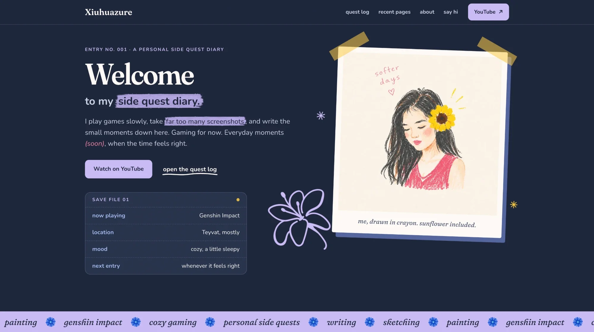

# xiuhuazure's corner

A personal side quest diary. Cozy gaming, personal side quests, and small moments worth keeping.

**Live:** [xiuhuazure.pages.dev](https://xiuhuazure.pages.dev) · **YouTube:** [@xiuhuazure](https://www.youtube.com/@xiuhuazure)



## Highlights

- **Built from my own brand guidelines.** Colours and type live in CSS design tokens, with dark and light themes per section.
- **Responsive and accessible.** Mobile first, 44px touch targets, visible focus ring, and animations pause for reduced motion.
- **Hand-drawn details in code.** A heart cursor that fills when you click, brush-stroke highlights, and a lily doodle tinted with CSS.
- **No framework, no build step.** Plain HTML, CSS and a little JavaScript, deployed on Cloudflare Pages.

## Run it locally

```bash
python3 -m http.server 8080
```

Then open http://localhost:8080.

## Credits

- Portrait, illustrations and brand guidelines: me
- Fonts: [Fraunces](https://fonts.google.com/specimen/Fraunces), [Nunito](https://fonts.google.com/specimen/Nunito) and [Dancing Script](https://fonts.google.com/specimen/Dancing+Script) (SIL Open Font License)
- Built with help from [Claude](https://claude.ai) by Anthropic

---

© Xiuhuazure. The code is here to look at and learn from; the portrait, illustrations and brand assets are not for reuse.
